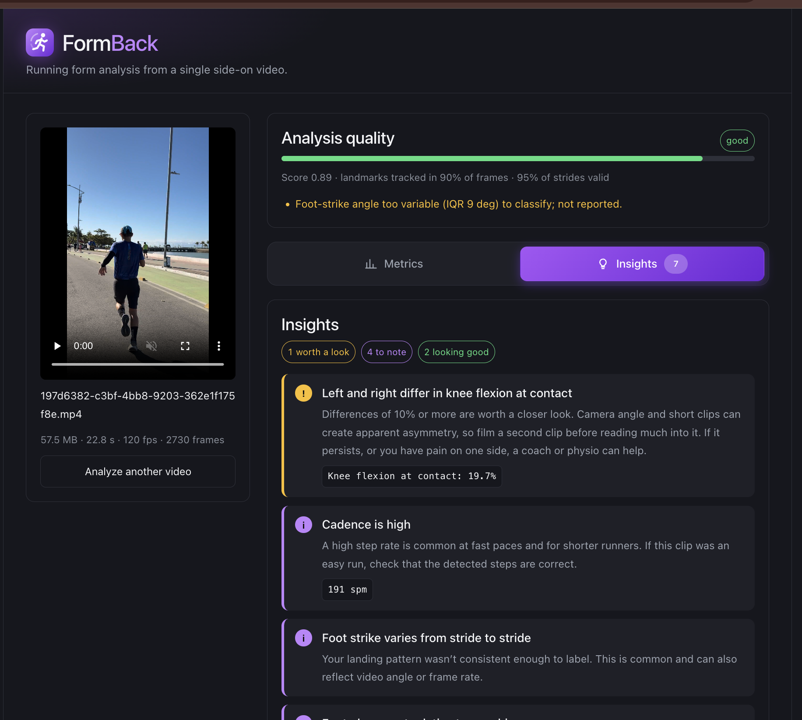

# FormBack 
**FormBack** is a running-form analysis tool that gives feedback from a single side-on video.

- **Upload:** add a short MP4 of yourself running, filmed from the side.
- **Analysis:** pose estimation tracks your body, detects each foot strike and measures every stride.
- **Metrics:** cadence, ground contact time, flight time, knee flexion, trunk lean, vertical oscillation and foot strike pattern.
- **Left vs. right:** per-leg results with an asymmetry score for each metric.
- **Insights:** a separate tab turns the numbers into plain-language feedback on what looks good and what is worth a closer look.
- **Reliability:** each metric has a confidence rating, and clips too poor to measure are flagged instead of showing misleading numbers.
- **Stack:** FastAPI backend and a React + TypeScript + Vite frontend.

## Pre-Upload Checklist

- [ ] Camera positioned directly beside the runner.
- [ ] Camera remains stationary.
- [ ] Full body, including both feet, is visible.
- [ ] Video is at least 720p and 30 FPS.
- [ ] Recording is 10–30 seconds long.
- [ ] Runner maintains a natural pace.

## Reference ranges and sources

The **Insights** tab compares your numbers against simple rules of thumb drawn
from published studies of recreational runners. They show what is *typical*,
not what is *ideal*, and they are not medical advice. 

| Metric | Rule in the app | Based on |
|---|---|---|
| Cadence | under 150 spm: lower; 150–185: typical; over 185: high | Malisoux 2023; De Ruiter 2020; Reinking 2025 |
| Left/right asymmetry | informational only; no pass/fail threshold | Malisoux 2024; Frontiers 2025 |
| Trunk lean | 2–12° typical; over 12° noted, not flagged | Teng & Powers 2014; Aslan 2024 |
| Ground contact time | over 0.35 s noted | Malisoux 2023 |
| Vertical oscillation | cutoffs are unvalidated heuristics | none (own estimate) |
| Overstriding | no cutoff; ankle-ahead-of-pelvis shown for tracking over time | none (no agreed threshold) |

### Studies
- **Malisoux et al. 2023**, *Orthop J Sports Med*: reference values from 860 recreational runners (cadence ~164 ± 9 spm, contact time ~289 ± 35 ms, vertical oscillation ~77 ± 12 mm). [Paper](https://doi.org/10.1177/23259671231204629) (CC BY-NC-ND, cited not reproduced)
- **Malisoux et al. 2024**, *BMJ Open Sport Exerc Med*: asymmetry not linked to injury in 800+ recreational runners; no clear "normal" threshold. [Paper](https://doi.org/10.1136/bmjsem-2023-001787)
- **Frontiers in Sports and Active Living 2025**: 250 healthy runners; a 10–15% asymmetry cutoff proposed for some sports is not validated. [Paper](https://www.frontiersin.org/articles/10.3389/fspor.2025.1560756/full)
- **De Ruiter et al. 2020**, *Eur J Sport Sci*: preferred cadence ~165 ± 8 spm vs. energetic optimum ~171 ± 8 (21 recreational runners). [Paper](https://doi.org/10.1080/17461391.2019.1626911)
- **Reinking et al. 2025**, *Int J Sports Phys Ther*: cadence rose from ~169 to ~178 spm as speed increased. [Paper](https://ijspt.scholasticahq.com/article/140544)
- **381-runner cohort**: mean step rate ~172 spm (uninjured) vs. ~173 (injured), no significant difference. [Paper](https://pmc.ncbi.nlm.nih.gov/articles/PMC7134352)
- **Teng & Powers 2014**, *JOSPT*: self-selected trunk flexion 7.3 ± 3.6° (24 recreational runners, 3.4 m/s). [PubMed](https://pubmed.ncbi.nlm.nih.gov/25155651/)
- **Aslan et al. 2024**, *PLOS ONE*: forward lean up to ~8° raised metabolic cost ~8%. [Paper](https://www.ncbi.nlm.nih.gov/pmc/articles/PMC11135760/)
