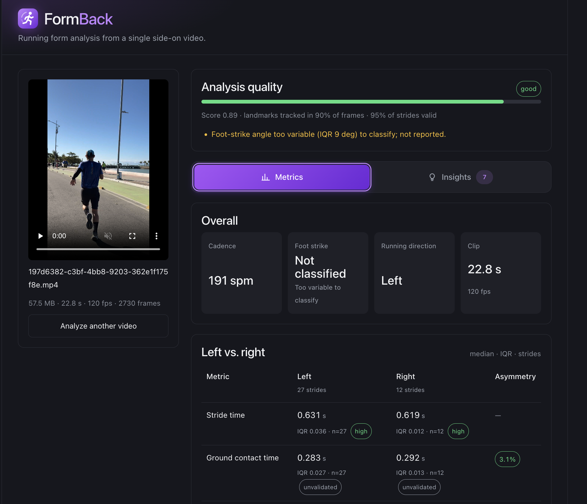

# FormBack 
**FormBack** is a running-form analysis tool that gives feedback from a single side-on video.

- **Upload:** add a short MP4 of yourself running, filmed from the side.
- **Analysis:** pose estimation tracks your body, detects each foot strike and measures every stride.
- **Metrics:** cadence, ground contact time, flight time, knee flexion, trunk lean, vertical oscillation and foot strike pattern.
- **Left vs. right:** per-leg results with an asymmetry score for each metric.
- **Insights:** a separate tab turns the numbers into plain-language feedback on what looks good and what is worth a closer look.
- **Reliability:** each metric has a confidence rating, and clips too poor to measure are flagged instead of showing misleading numbers.
- **Stack:** FastAPI backend and a React + TypeScript + Vite frontend.

## Pre-Upload Checklist

- [ ] Camera positioned directly beside the runner.
- [ ] Camera remains stationary.
- [ ] Full body, including both feet, is visible.
- [ ] Video is at least 720p and 30 FPS.
- [ ] Recording is 10–30 seconds long.
- [ ] Runner maintains a natural pace.

## Important

FormBack uses computer vision to estimate body landmarks and analyze running movement. Recording quality affects measurement reliability. Results are intended for coaching and performance review, not medical diagnosis.